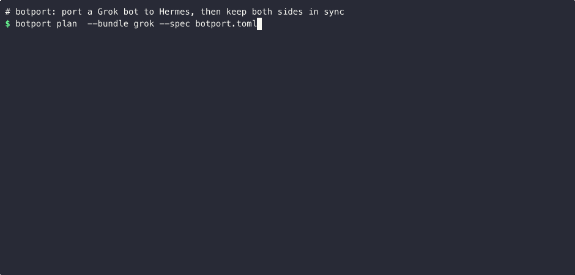
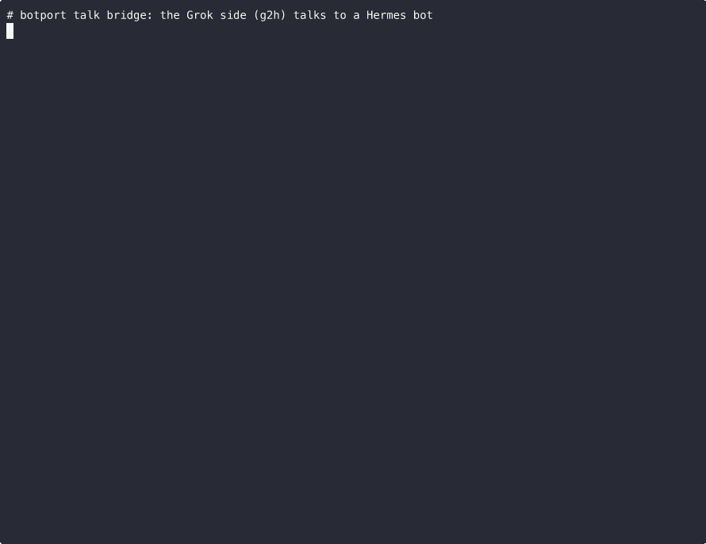

# botport

**botport connects a bot in xAI's [Grok Bot](https://grok.com) with a bot in open-source Nous Research's
[Hermes Agent](https://github.com/NousResearch/hermes-agent).**

## What works today, between a Grok Bot and a Hermes bot
1. **Export and import, both directions.** The Grok Bot exports itself into a bundle and `botport apply` turns it
   into a Hermes profile; `botport export-hermes` sends what the Hermes bot learned back as a bundle the Grok Bot
   loads. How: [user guide](docs/USER-GUIDE.md), [export brief](docs/AGENT-EXPORT.md),
   [import brief](docs/AGENT-IMPORT.md).
2. **Sync both directions, with drift detection.** `botport sync` re-applies only what changed and `botport drift`
   checks both directions. An edit you made on the Hermes side is reported as a conflict and never overwritten.
   How: [sync and drift](docs/USER-GUIDE.md), [ownership rules](docs/REFERENCE.md).
3. **Direct chat between the two bots (optional).** The separate `g2h` bridge lets them message each other, 0.6–1.5 s per
   exchange, measured live. How: [bridge setup brief](docs/AGENT-SETUP.md), [g2h README](crates/g2h/README.md).

g2h is a bridge between two bots **you own**, both running as your user. It frames one bot's text as untrusted data for
the other, which reduces the chance that a bot treats peer text as instructions; no framing can guarantee that. It is **not** a security boundary against a bot that already has a shell as your user;
see [SECURITY.md](docs/SECURITY.md).

### Tried on a real bot (2 Nov 2026)
- A real Grok Bot ran the in-box export.
- The bundle was imported into a Hermes bot and synced; `drift` reported IN SYNC in both directions.
- The two bots exchanged messages live over g2h: 10 of 10 back-and-forth exchanges passed, 0.6–1.5 s each.
- A live owner-approved operation: one bot asked the other to export itself, and it did.
- Upstream Hermes' own Grok Bot importer was tested on the same bot; testing found a bug (escaped skill text), and a fix
  is prepared for upstream.

Platform changes we hit and how the brief or tool adapted are logged in
[docs/PLATFORM-CHANGES.md](docs/PLATFORM-CHANGES.md).

## botport or `hermes migrate grok-bot`?
Hermes has an official Grok Bot importer in the agent-importers plugin, v1.2.0 or later
([NousResearch/hermes-official-plugins#248](https://github.com/NousResearch/hermes-official-plugins/pull/248)). The
bot writes a `grok-bot-export.json` about itself, and `hermes import-agent grok-bot` turns its scheduled routines into
paused cron jobs (event-triggered routines become notes), plus skills, memories, its role and remote MCP apps. On
Hermes newer than v0.22.5 (its main branch today), `hermes migrate grok-bot` installs that plugin and runs it
([NousResearch/hermes-agent#147724](https://github.com/NousResearch/hermes-agent/pull/147724)); on v0.22.5 and older,
install agent-importers 1.2.0 or later yourself and run `hermes import-agent grok-bot`. **For a one-off move, use
that.**

botport is for when you keep both bots:
- **Ongoing two-way sync** with ownership records: a re-run updates what botport wrote and never overwrites an edit
  made on the Hermes side (that shows up as a conflict in `drift`).
- **Drift reports** in both directions, a **restore point** before every apply, and **export back** to the Grok Bot
  (`export-hermes`).
- **The g2h bridge**, so the two bots can talk to each other.

botport reads the same `grok-bot-export` v1 format as the upstream importer, as well as its own in-box bundle. Its
mapping follows agent-importers, and credit goes to that project (see [NOTICE](NOTICE)).

## Where it's going (roadmap)
Start with [docs/OWNERSHIP.md](docs/OWNERSHIP.md): one page on the ownership rules that are botport's core (what it
records, when it writes, and when it refuses to overwrite a Hermes-side edit).

| Item | Status |
|---|---|
| Neutral `BotModel` + `Adapter` seam routing plan/apply/sync/drift | done (v0.1.0) |
| OpenClaw (formerly Moltbot/Clawdbot) adapter | planned |
| OpenBot adapter | planned |
| `g2hd` running as a separate OS user | implemented, opt-in (not yet run in production) |

OpenClaw and OpenBot are named because they are the platforms the `BotModel` seam is meant for, but neither has any
code yet, and neither is a small first contribution. Porting a bot *from* a new platform needs an adapter that reads
it into (and writes it from) the model and passes the conformance suite, plus a way to select it as a source in the
CLI (today only `--bundle`, the Grok Bot source). Porting *into* it also needs a `Target` (Hermes is the only one
today) that implements the rules in [docs/OWNERSHIP.md](docs/OWNERSHIP.md); the two-way export back to Grok is
Hermes-specific code.

**g2h is an optional, experimental companion and is feature-frozen for v0.1**: bug fixes only, no new features;
separate-user hardening (#17) is post-launch.

Details in [ROADMAP.md](ROADMAP.md) and [docs/ARCHITECTURE.md](docs/ARCHITECTURE.md#today-vs-target).

## Demos



The demo is a real run of the built binary on the made-up [Acme example](examples/acme/) in an empty home
directory. It is also available as an [asciinema cast](docs/assets/demo.cast) (`asciinema play docs/assets/demo.cast`).



The talk bridge, recorded live with the current build: the Grok side's `g2h` CLI talks to a Hermes bot (a throwaway
demo profile on a local model, `dry_run` on, no webhook credentials). The two `g2h ask` turns took 1.9 s and 1.5 s end
to end (first token in 0.8 s and 0.4 s); the queued `g2h send` reply reached `g2h wait` in 2.2 s. Also an
[asciinema cast](docs/assets/talk.cast).

## The easy way: ask your agent
If you use an agent such as Claude Code, a Hermes bot, or a Grok Bot with a computer connector, point it at
[docs/AGENT-SETUP.md](docs/AGENT-SETUP.md) and ask it to set things up. The brief tells it what to check, the one
message it should send you, and how to keep secrets out of the chat.
For a Grok Bot exporting itself, use [docs/AGENT-EXPORT.md](docs/AGENT-EXPORT.md).

## Manual quickstart (about 5 minutes)
1. Install: see [docs/INSTALL.md](docs/INSTALL.md) (curl script, or `pipx install botport` once it is on PyPI), or build from source with `cargo build --release` and add
   `target/release` to your `PATH` (`export PATH="$PWD/target/release:$PATH"`).
2. Try it on the example bot. Nothing here touches your real Hermes setup:
   ```sh
   export HOME="$(mktemp -d)"         # throwaway home
   export G2H_HOME="$HOME/.g2h"        # separate line: on one line $HOME would still be the real one
   unset HERMES_HOME                   # botport follows $HERMES_HOME before ~/.hermes
   cd examples/acme
   botport plan  --bundle grok --spec botport.toml   # what would change (dry run)
   botport apply --bundle grok --spec botport.toml --no-cron   # write the profile; drop --no-cron if hermes is installed
   botport drift --bundle grok --spec botport.toml   # exit 0 = in sync, 1 = something differs
   ```
   The profile is named `acme-helper` (from the spec); add `--profile NAME` to each command to use another name.
   `--no-cron` skips the example's cron jobs, which `apply` creates through the `hermes` command. With `hermes` on
   your `PATH` ([how to install it](docs/INSTALL.md#requirements)), leave it out.
3. Port your own bot: follow the [user guide](docs/USER-GUIDE.md). It covers export, import, sync, testing and undo.

## What it does
Two tools: **botport** ports and syncs the bot; **g2h** (`g2h` CLI, `g2hd` daemon) is an optional, experimental
companion that lets the two copies talk. botport works on its own: you do not need to install or run g2h to port, sync
or test a bot. g2h is feature-frozen for v0.1 (bug fixes only, no new features); separate-user hardening (#17)
is post-launch.
- **Port.** `export` makes a bundle from a Grok Bot: skills, memory, chat history (read-only), and a checklist of
  what it can't copy. `plan` and `apply` turn that bundle into a Hermes profile. A short spec file says which parts
  of the profile botport owns.
- **Sync and drift.** `sync` re-applies only when something changed. `drift` checks both directions. An edit made on
  the Hermes side is reported as a **conflict** and never overwritten. Every apply writes a restore point first.
  With two-way sync, what the Hermes bot learned goes back to the Grok bot as a bundle it can load.
- **Parity tests.** `test` runs a small battery of questions against the Hermes copy, to check that the persona,
  memory and routines came across. See the [worked example](docs/examples/daily-wisdom.md).
- **Talk bridge (`g2h`, optional).** `g2hd` is a local broker on a Unix socket, with no network listener. It lets the Grok Bot
  and the Hermes bot message each other, with daily caps and an owner approval step for actions. It is a bridge
  between two bots you own, not a security boundary between them. See
  [crates/g2h/README.md](crates/g2h/README.md) and the [security model](docs/SECURITY.md).

Output is terse: 10 lines or fewer per command, or `--json`. Full detail goes to a file. The same input gives
byte-identical output. Secrets are never exported on purpose: a write guard refuses known secret shapes. It is a
detector, not a guarantee (see [the security model](docs/SECURITY.md)).

## Honest limits
- **The Grok side is the hard part.** Grok has no export API, so the bot exports itself by following a brief. Its
  instructions, schedules, connectors and credentials can't be copied as files. The bot describes them, and import
  turns that description into paused cron jobs, MCP entries and a manual checklist.
- **Some features have no Hermes equivalent.** Grok Pages and canvas, image cards and Grok workspace files don't
  carry over.
- **Parity is not identity.** A different model behaves differently. In the worked example the battery passes 4 of
  5 questions; the failure is the model not loading the memory skill.
- **g2h needs both bots running.** `g2h selftest` needs a live Hermes gateway (`g2h selftest --wake-only` does not;
  see [trying the bridge locally](docs/INSTALL.md#try-the-bridge-locally-no-service-installed)), and waking the Grok
  side needs a Grok routine webhook. It runs on macOS and Linux only; there is no Windows support yet.
- Only Grok Bot ↔ Hermes works today. OpenClaw and OpenBot are planned; their mappings exist only on paper, in
  [docs/MODEL.md](docs/MODEL.md).

## Status
**v0.1, early, one maintainer.** Tried end to end on a real Grok Bot and Hermes bot (see above). The file formats
are versioned (`bot-model/1`), but expect rough edges. Bug reports with the `--json` output attached are very
welcome. The project is looking for a co-maintainer who runs Grok Bots daily; see [CONTRIBUTING.md](CONTRIBUTING.md),
the [roadmap](ROADMAP.md) and the [changelog](CHANGELOG.md).

## How this was built
The code and docs were written by Claude agents, directed by Josh, the maintainer. Each change was checked by a
separate Claude agent acting as auditor (a fresh session with its own checklist), plus the tests and CI (fmt, clippy,
the full test suite and cargo-deny on Linux and macOS). Near launch, three fresh-context Claude critique passes reviewed
the repo. The work before the first outside review is one squashed commit; everything after it is kept as separate,
reviewed commits.

## Docs and contributing
- [docs/README.md](docs/README.md): every guide, in one list.
- [CONTRIBUTING.md](CONTRIBUTING.md): build, test, and send a pull request. Good first contributions: a
  [PLATFORM-CHANGES](docs/PLATFORM-CHANGES.md) entry from a bot you run,
  [#16](https://github.com/hudsonwa/botport/issues/16), [#5](https://github.com/hudsonwa/botport/issues/5).
- [CODE_OF_CONDUCT.md](CODE_OF_CONDUCT.md).

## License and credits
MIT, see [LICENSE](LICENSE). botport re-implements ideas from grok-bot-backup and NousResearch's agent-importers;
see [NOTICE](NOTICE). The worked example uses a public template by Michael Gannotti (SMF Works).
